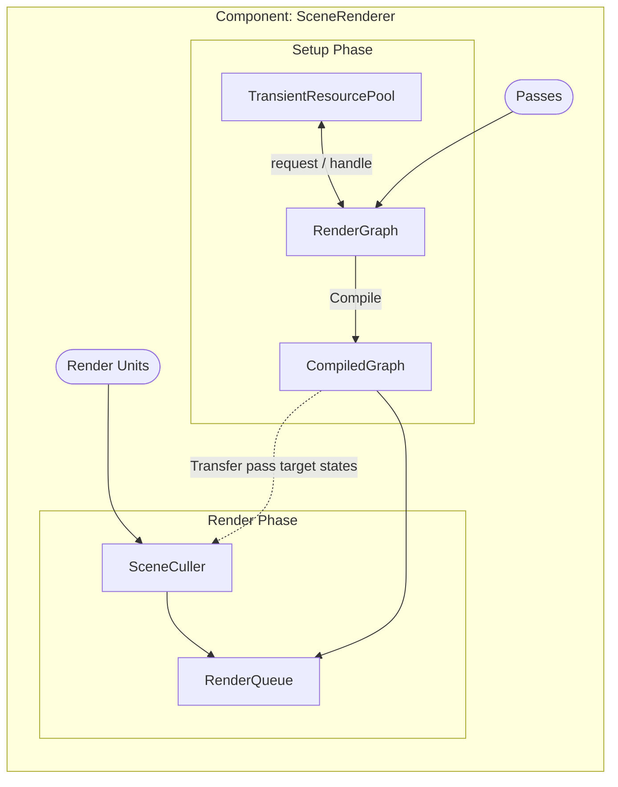
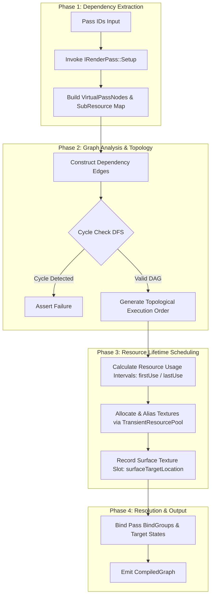

# RenderGraph

## Purpose

Abstracts frame rendering into a DAG of stateless pass declarations. It compiles declared resource dependencies into an execution topology, then allocates and aliases transient GPU textures across non-overlapping passes to minimize memory overhead.

## System Components

| Type                      | Role                                                                                                 |
| ------------------------- | ---------------------------------------------------------------------------------------------------- |
| **RenderGraph**           | Compiles stateless pass declarations into a `CompiledGraph`                                          |
| **RenderQueue**           | Stores per-pass `RenderIntent` vectors, procedural pipelines and camera data submitted for execution |
| **TransientResourcePool** | Manages WebGPU resource handles and aliases for transient resources across non-overlapping passes    |
| **CompiledGraph**         | Stores all passes, their resource and topological execution order                                      |
| **SceneCuller**           | Performs frustum culling and generates per-pass render intents for the scene                         |

## Data Flow

### Architecture Overview

### RenderGraph Compile Flow Chart

## Design Decisions

We adopted a DAG-based render graph to maximize performance and scalability. [^adr-002]

The architecture is strictly constrained to WebGPU. Consequently, explicit memory aliasing and manual barrier synchronization features are omitted. [^adr-001]

## Entry Points

- The primary entry points for the [Architecture Overview](#architecture-overview) are [`RenderGraph.h`](../../core/render/graph/RenderGraph.h) and [`SceneRenderer.h`](../../core/render/SceneRenderer.h).
- The logic for the [Flow Chart](#rendergraph-compile-flow-chart) is implemented in [RenderGraph.cpp](../../core/render/graph/RenderGraph.cpp).
